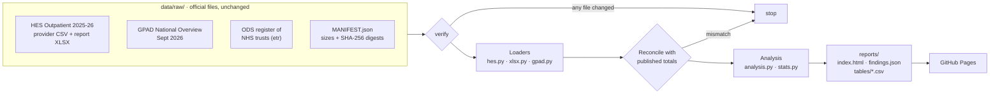

<div align="center">

# Who misses NHS outpatient appointments?

**An auditable analysis of 150 million NHS outpatient appointments, written for the service manager who has to act on it.**

[](https://github.com/gbadedata/nhs-access-equity-lab/actions/workflows/ci.yml)
[](https://gbadedata.github.io/nhs-access-equity-lab/)


[](LICENSE)

[**Live report**](https://gbadedata.github.io/nhs-access-equity-lab/) · [Methods](docs/methods.md) · [Findings as JSON](reports/findings.json) · [Tables as CSV](reports/tables/) · [Changelog](CHANGELOG.md)

</div>

<p align="center">
  <a href="https://gbadedata.github.io/nhs-access-equity-lab/">
    <picture>
      <source media="(prefers-color-scheme: dark)" srcset="docs/images/hero-dark.png">
      
    </picture>
  </a>
</p>

## The short version

Missed hospital appointments are usually discussed as a patient behaviour problem. NHS England's own 2025-26 data tells a fuller story:

| | Finding | What a manager should do |
|---|---|---|
| 1 | Hospitals cancelled **13.9m** appointments, **1.7 times** the 8.2m patients missed | Look at cancellations before patient behaviour |
| 2 | Men aged 20-24 miss **13.8%** of appointments; people in their late 70s about **3.5%** | Design reminders and booking with the groups who miss most |
| 3 | Black patients' DNA rate is **1.81 times** the White rate, but part of that is age, and **18.9%** of attendances have no ethnicity recorded | Fix ethnicity recording before drawing equity conclusions |
| 4 | Remote first appointments are missed less: **4.3%** against **7.0%** in person | Pilot remote options with an evaluation, keeping in-person routes |
| 5 | Plain statistics flag **142 of 151** trusts as outliers; allowing for normal variation, **6** | Compare trusts of the same type before judging any of them |

Every figure is computed from the official files in [`data/raw/`](data/raw/). None is typed in by hand.

## Contents

[Findings](#findings) · [Why the numbers hold up](#why-the-numbers-hold-up) · [How it works](#how-it-works) · [Quickstart](#quickstart) · [Methods](#methods-in-brief) · [Data sources](#data-sources) · [Repository layout](#repository-layout) · [Limits](#limits) · [Roadmap](#roadmap) · [Citation and licence](#citation-and-licence)

## Findings

### Hospital cancellations have grown while missed appointments have fallen

<picture>
  <source media="(prefers-color-scheme: dark)" srcset="docs/images/trend-dark.png">
  
</picture>

Hospital cancellations rose from 6.8% of appointments in 2015-16 to 9.3% in 2025-26, while DNAs fell from 6.6% to 5.4%. The hospital cancels 13.9% of London-commissioned appointments, against 5.6% in the South West. Part of that regional gap may be recording practice, which is itself worth checking.

### Young adults, and young men most, miss the most appointments

<picture>
  <source media="(prefers-color-scheme: dark)" srcset="docs/images/age-dark.png">
  
</picture>

The age gradient is steep: men aged 20-24 miss 13.8% of booked appointments, people aged 75-79 about 3.5%. These are the groups to involve in redesigning reminders, booking and timing.

### Ethnicity: a real gap, measured on incomplete data

Black patients' DNA rate is 8.8%, against 4.9% for White patients (ratio 1.81). Mixed (7.6%), Other (7.5%) and Asian (6.5%) groups are also above the White rate. Two things stop this being a finding about ethnicity yet:

- **Age.** In the 2021 Census the median age was 43 for the White group, 32 for the Asian and Black groups and 19 for the Mixed group. DNA rates fall steeply with age, and the published tables cannot be age-standardised.
- **Missing data.** 18.9% of attendances have ethnicity "Not known" or "Not stated". If recording is worse for some groups, the gaps could be larger or smaller than they look.

### Remote appointments have lower recorded DNA rates

First appointments by telephone or video are missed 4.3% of the time, against 7.0% in person; follow-ups 4.8% against 6.8%. Patients, specialties and the way a missed call is recorded all differ between the two, so this is a reason to pilot and evaluate, not proof that remote appointments cause better attendance.

### Most variation between trusts is expected

<picture>
  <source media="(prefers-color-scheme: dark)" srcset="docs/images/funnel-dark.png">
  
</picture>

With very large trusts, plain binomial limits are so narrow that 142 of 151 trusts look like outliers. Allowing for genuine between-trust variation ([Spiegelhalter 2005](https://doi.org/10.1002/sim.1970)), four sit above the 99.8% limit and two below. The high ones are three mental health and community trusts and a children's hospital, whose clinics are not comparable with an acute hospital's. The two lowest are community trusts with DNA rates under 1%, which points to how DNAs are recorded. Two more trusts cross the line if the model is fitted without the variance-stabilising transformation; the report names them as borderline.

Four trusts are left out because more than 5% of their outcomes are unknown. East London NHS Foundation Trust's 88,765 appointments **all** have an unknown outcome: a naive ranking would have put it first in England with a 0% DNA rate.

The [live report](https://gbadedata.github.io/nhs-access-equity-lab/) also covers regions, deprivation deciles, specialties and 30 months of GP appointments by mode.

## Why the numbers hold up

| Check | What it guarantees | Where |
|---|---|---|
| SHA-256 manifest of every source file | The data is exactly what NHS England published; a changed file stops the run | [`data/raw/MANIFEST.json`](data/raw/MANIFEST.json), `python -m nhs_outpatients verify` |
| Rebuilds the publication's headline: 150,317,821 appointments, 8,151,086 DNAs | Nothing is lost or double-counted in parsing | [`tests/test_nhs_outpatients.py`](tests/test_nhs_outpatients.py) |
| Reproduces NHS England's published DNA proportion for every ethnic group | The ethnicity tables are read correctly | same |
| CI rebuilds the report and diffs it against the committed one | What you read is what the code produces, on Python 3.11, 3.12 and 3.13 | [`.github/workflows/ci.yml`](.github/workflows/ci.yml) |
| Outcome-recording screen, with exclusions listed | No trust is ranked on data it didn't record | [`nhs_outpatients/analysis.py`](nhs_outpatients/analysis.py) |
| Providers identified through the ODS trust register | NHS trusts are not confused with independent-sector sites | same |
| Publisher conventions handled explicitly | `*` stays missing, not zero; rounding to 5 and the 2010 deprivation index are stated | [`docs/methods.md`](docs/methods.md) |
| Standard-library XLSX reader tested against openpyxl | No hidden parsing differences, no dependencies | [`nhs_outpatients/xlsx.py`](nhs_outpatients/xlsx.py) |

51 tests in total.

## How it works



## Quickstart

Python 3.11 or later. Nothing to install.

```bash
git clone https://github.com/gbadedata/nhs-access-equity-lab.git
cd nhs-access-equity-lab

python -m nhs_outpatients verify          # check all six source files against MANIFEST.json
python -m nhs_outpatients                 # rebuild the report
python -m unittest discover -s tests      # 51 tests
```

Expected output of the second command:

```text
150,317,821 appointments, DNA 5.42%. Report: reports/index.html
```

| Output | Contents |
|---|---|
| `reports/index.html` | The report: findings, charts with hover detail, data tables, definitions, sources |
| `reports/findings.json` | Every computed figure, for reuse |
| `reports/tables/*.csv` | Tidy tables behind each chart, ready for Excel or Power BI |

## Methods in brief

| Measure | Definition |
|---|---|
| DNA rate: headline, trend, ethnicity, region | DNAs ÷ all appointments, matching the HES publication |
| DNA rate: age, appointment type, specialty | DNAs ÷ (attended + DNA); those tables publish no cancellations |
| DNA rate: trust comparison | DNAs ÷ appointments with a recorded outcome |
| Ratio to the White group | Ratio of two proportions, 95% interval on the log scale (Katz) |
| GP DNA rate | DNA ÷ (attended + DNA); about 6% of GP appointments have an unknown status |

Funnel plot limits are set on the variance-stabilising arcsine scale, with between-trust variance τ² estimated from winsorised z-scores (Spiegelhalter 2005) and z = 1.96 or 3.09:

$$\sin^2\left(\arcsin\sqrt{p_0} \pm z\sqrt{\frac{1}{4n} + \tau^2}\right)$$

Full detail, including every reconciliation check, is in [`docs/methods.md`](docs/methods.md). Design decisions are in [`docs/decision_log.md`](docs/decision_log.md).

## Data sources

All retrieved 7 November 2026 and committed unchanged.

| Dataset | Publisher | Published | Used for |
|---|---|---|---|
| [Hospital Outpatient Activity 2025-26](https://digital.nhs.uk/data-and-information/publications/statistical/hospital-outpatient-activity/2025-26): provider-level analysis, report tables, ethnicity and IMD data, metadata | NHS England | 24 Sep 2026 | Everything about hospital outpatients |
| [Appointments in General Practice, September 2026](https://digital.nhs.uk/data-and-information/publications/statistical/appointments-in-general-practice/september-2026): National Overview | NHS England | 29 Oct 2026 | GP DNA rate by appointment mode |
| ODS `etr` report, NHS trusts | NHS England Organisation Data Service | weekly | Identifying NHS trusts |
| [Ethnic group by age and sex, Census 2021](https://www.ons.gov.uk/peoplepopulationandcommunity/culturalidentity/ethnicity/articles/ethnicgroupbyageandsexenglandandwales/latest) | ONS | 23 Jan 2023 | Median ages (context only) |

## Repository layout

```text
nhs-access-equity-lab/
├── nhs_outpatients/        real-data analysis
│   ├── sources.py          manifest and integrity check
│   ├── hes.py · gpad.py    loaders for the published files
│   ├── xlsx.py             standard-library .xlsx reader
│   ├── stats.py            Wilson intervals, ratios, funnel overdispersion
│   ├── analysis.py         every figure in the report
│   └── report.py           HTML report and CSV tables
├── data/raw/               official files + MANIFEST.json
├── reports/                generated report, findings, tables
├── access_lab/             synthetic test harness (see below)
├── tests/                  51 tests
└── docs/                   methods, decisions, brief, governance
```

The `access_lab/` package generates seeded, fully synthetic appointments with planted patterns. It tests the CSV contract, reason-coded quarantine, audit logging and small-number suppression against inputs where the right answer is known (`python -m access_lab run --output build`). Its numbers are invented and are never mixed with the real analysis.

## Limits

- National aggregate statistics: they describe patterns, not individual patients, and cannot say why anyone missed an appointment.
- Nothing is age-standardised or adjusted for need, specialty mix or trust type. The report says where that matters.
- GP "video or online" appointments include asynchronous online consultations, where there is little to miss.
- Independent work, not affiliated with or endorsed by NHS England.

## Roadmap

- [ ] Age-standardise DNA rates by ethnicity and deprivation, using finer data such as an approved HES extract
- [ ] Compare trusts within type (acute, mental health, community, specialist), with specialty-mix adjustment
- [ ] Add the 2026-27 release when NHS England publishes it, and track change year on year
- [ ] Design a pre-registered evaluation for a reminder or booking change, keeping in-person routes open

## Citation and licence

To cite this analysis, use the metadata in [`CITATION.cff`](CITATION.cff) (GitHub's "Cite this repository" button reads it).

Code: [MIT](LICENSE). Data: contains public sector information licensed under the [Open Government Licence v3.0](https://www.nationalarchives.gov.uk/doc/open-government-licence/version/3/).

Built by [Oluwagbade Odimayo](https://gbadedata.com). Questions and corrections are welcome as [issues](https://github.com/gbadedata/nhs-access-equity-lab/issues).
