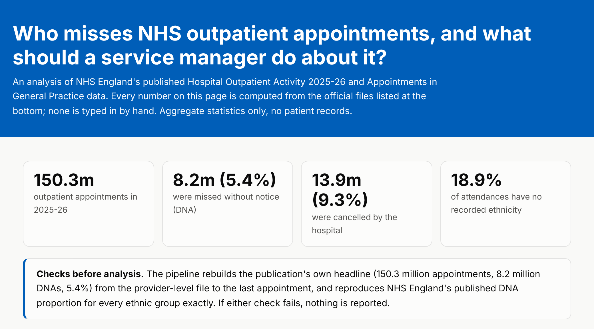
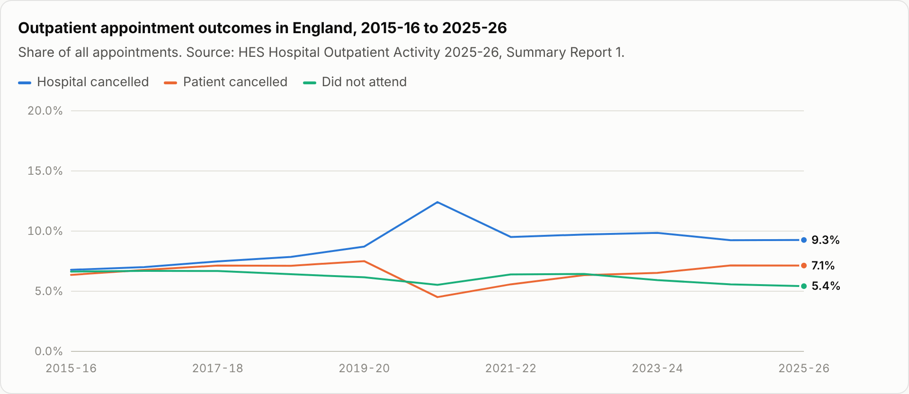
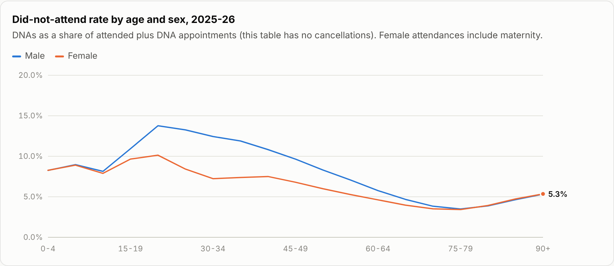
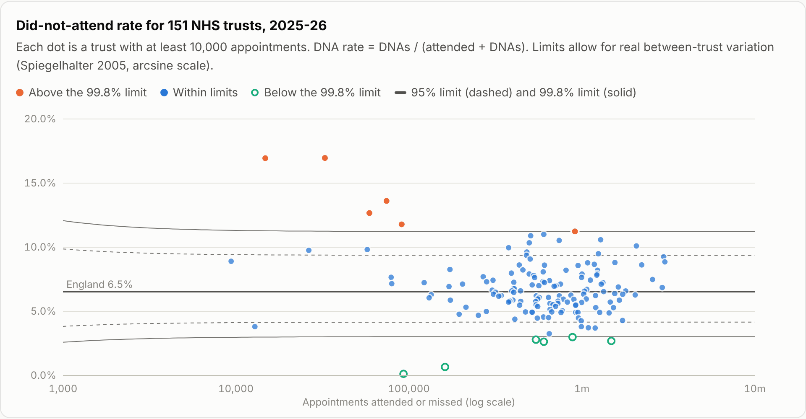
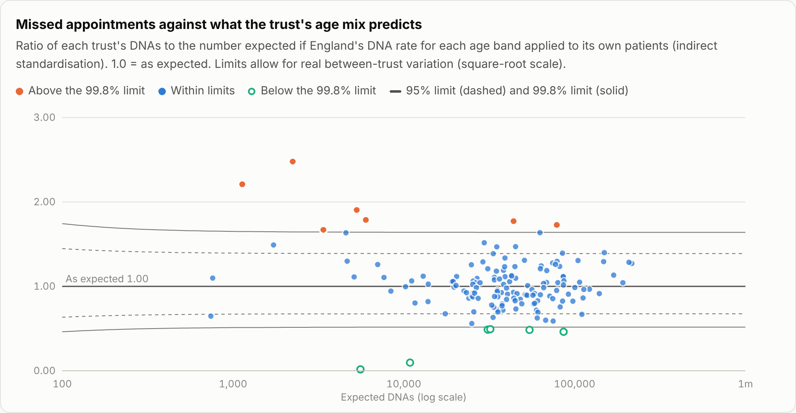
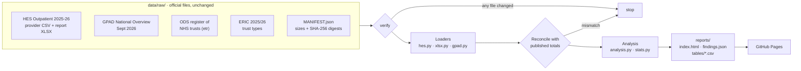

<div align="center">

# Who misses NHS outpatient appointments?

**An auditable analysis of 150 million NHS outpatient appointments, written for the service manager who has to act on it.**

[](https://github.com/gbadedata/nhs-access-equity-lab/actions/workflows/ci.yml)
[](https://gbadedata.github.io/nhs-access-equity-lab/)


[](LICENSE)

[**Live report**](https://gbadedata.github.io/nhs-access-equity-lab/) · [Methods](docs/methods.md) · [Findings as JSON](reports/findings.json) · [Tables as CSV](reports/tables/) · [Changelog](CHANGELOG.md)

</div>

<p align="center">
  <a href="https://gbadedata.github.io/nhs-access-equity-lab/">
    <picture>
      <source media="(prefers-color-scheme: dark)" srcset="docs/images/hero-dark.png">
      
    </picture>
  </a>
</p>

## The short version

Missed hospital appointments are usually discussed as a patient behaviour problem, and NHS England asks providers to reduce them without widening health inequalities ([PR2012](#ref-nhse-dna)). Its own 2025-26 data tells a fuller story:

| | Finding | What a manager should do |
|---|---|---|
| 1 | Hospitals cancelled **13.9m** appointments, **1.7 times** the 8.2m patients missed | Look at cancellations before patient behaviour |
| 2 | Men aged 20-24 miss **13.8%** of appointments; people in their late 70s about **3.5%** | Design reminders and booking with the groups who miss most |
| 3 | Black patients' DNA rate is **1.81 times** the White rate, but part of that is age, and **18.9%** of attendances have no ethnicity recorded | Fix ethnicity recording before drawing equity conclusions |
| 4 | Remote first appointments are missed less: **4.3%** against **7.0%** in person | Pilot remote options with an evaluation, keeping in-person routes |
| 5 | Plain statistics flag **144 of 151** trusts as outliers; allowing for normal variation, **12**; compared like with like, only **3** | Compare trusts by age mix and type before judging any of them |

Every figure is computed from the official files in [`data/raw/`](data/raw/). None is typed in by hand.

## Contents

[Findings](#findings) · [Why the numbers hold up](#why-the-numbers-hold-up) · [How it works](#how-it-works) · [Quickstart](#quickstart) · [Methods](#methods-in-brief) · [Data sources](#data-sources) · [Repository layout](#repository-layout) · [Limits](#limits) · [Roadmap](#roadmap) · [References](#references) · [Citation and licence](#citation-and-licence)

## Findings

### Hospital cancellations have grown while missed appointments have fallen

<picture>
  <source media="(prefers-color-scheme: dark)" srcset="docs/images/trend-dark.png">
  
</picture>

Hospital cancellations rose from 6.8% of appointments in 2015-16 to 9.3% in 2025-26, while DNAs fell from 6.6% to 5.4%. The hospital cancels 13.9% of London-commissioned appointments, against 5.6% in the South West. Part of that regional gap may be recording practice, which is itself worth checking.

### Young adults, and young men most, miss the most appointments

<picture>
  <source media="(prefers-color-scheme: dark)" srcset="docs/images/age-dark.png">
  
</picture>

The age gradient is steep: men aged 20-24 miss 13.8% of booked appointments, people aged 75-79 about 3.5%. These are the groups to involve in redesigning reminders, booking and timing.

### Ethnicity: a real gap, measured on incomplete data

Black patients' DNA rate is 8.8%, against 4.9% for White patients (ratio 1.81). Mixed (7.6%), Other (7.5%) and Asian (6.5%) groups are also above the White rate. Two things stop this being a finding about ethnicity yet:

- **Age.** In the 2021 Census the median age was 43 for the White group, 32 for the Asian and Black groups and 19 for the Mixed group. DNA rates fall steeply with age, and the published tables cannot be age-standardised.
- **Missing data.** 18.9% of attendances have ethnicity "Not known" or "Not stated". If recording is worse for some groups, the gaps could be larger or smaller than they look.

### Remote appointments have lower recorded DNA rates

First appointments by telephone or video are missed 4.3% of the time, against 7.0% in person; follow-ups 4.8% against 6.8%. Patients, specialties and the way a missed call is recorded all differ between the two, so this is a reason to pilot and evaluate, not proof that remote appointments cause better attendance.

### Compared like with like, only 3 trusts stand out

A single league table mixes acute hospitals with mental health, community and specialist trusts. Each trust is compared three ways: against England, after allowing for the age of its patients, and against trusts of the same type in NHS England's [Estates Returns Information Collection](https://digital.nhs.uk/data-and-information/publications/statistical/estates-returns-information-collection/summary-page-and-dataset-for-eric-2025-26) (ERIC).

<picture>
  <source media="(prefers-color-scheme: dark)" srcset="docs/images/funnel-dark.png">
  
</picture>

With very large trusts, plain binomial limits are so narrow that 144 of 151 trusts look like outliers. Allowing for genuine between-trust variation (Spiegelhalter [2005a](#ref-spiegelhalter-funnel), [2005b](#ref-spiegelhalter-od)), 6 sit above the 99.8% limit and 6 below.

<picture>
  <source media="(prefers-color-scheme: dark)" srcset="docs/images/funnel-age-dark.png">
  
</picture>

Allowing for age moves trusts both ways: a mental health trust whose patients are young drops back inside the limits, and an eye hospital whose patients are old moves outside them. Comparing each trust only with its own type moves the list again. Every trust outside the 99.8% limits on at least one view, with the 3 that stand out on all three in bold:

| Trust | ERIC type | DNA rate | Against England | Allowing for age | Against same type |
|---|---|---|---|---|---|
| **North Staffordshire Combined Healthcare** | Mental health and learning disability | 17.0% | Higher | Higher | Higher |
| Oxleas | Mental health and learning disability | 16.9% | Higher | Higher | · |
| Lancashire & South Cumbria | Mental health and learning disability | 13.6% | Higher | Higher | · |
| Leicestershire Partnership | Mental health and learning disability | 12.7% | Higher | · | · |
| Herefordshire and Worcestershire Health and Care | Community | 11.8% | Higher | Higher | no limits |
| Barking, Havering and Redbridge University Hospitals | Acute - teaching | 11.2% | Higher | · | Higher |
| Liverpool University Hospitals | Acute - teaching | 10.6% | · | Higher | Higher |
| Moorfields Eye Hospital | Acute - specialist | 10.5% | · | Higher | · |
| Midlands Partnership University | Mental health and learning disability | 9.8% | · | Higher | · |
| **Norfolk and Norwich University Hospitals** | Acute - teaching | 3.0% | Lower | Lower | Lower |
| The Royal Marsden | Acute - specialist | 2.8% | Lower | Lower | · |
| Dorset Healthcare University | Mental health and learning disability | 2.7% | Lower | Lower | · |
| The Christie | Acute - specialist | 2.6% | Lower | Lower | · |
| Leeds Community Healthcare | Community | 0.7% | Lower | Lower | no limits |
| **Cornwall Partnership** | Mental health and learning disability | 0.1% | Lower | Lower | Lower |

| Peer group | Trusts | Group ratio to England, age-adjusted | Outside the 99.8% limits |
|---|---|---|---|
| Acute | 115 | 1.03 | 2 higher, 1 lower |
| Acute specialist | 16 | 0.95 | 0 higher, 0 lower |
| Community and care | 7 | 1.25 | too few for limits (minimum 8) |
| Mental health and learning disability | 13 | 0.86 | 1 higher, 1 lower |

Only 13 of England's 45 mental health and learning disability trusts appear, because much of what they do is recorded in the [Mental Health Services Data Set](#ref-mhsds) rather than HES. The trusts that stand out on every view are where a conversation with the information team should start, beginning with how missed appointments are recorded: Cornwall Partnership's rate of 0.1% looks more like a question about how DNAs are recorded than a near-perfect clinic.

**Why cancellations are left out of the rate.** 22 of the 151 trusts report no patient or hospital cancellations to HES at all, while at a typical trust cancellations are about a fifth of appointments. Version 0.2.2 divided DNAs by every appointment with a recorded outcome, which made those trusts' rates look higher purely because of how they record cancellations. The trust comparison now uses DNAs ÷ (attended + DNAs), the definition UK official statistics use for comparing missed appointments ([NISRA](#ref-nisra)). The old definition is kept as a sensitivity check and reproduces version 0.2.2's 4 above and 2 below exactly.

Four trusts are left out because more than 5% of their outcomes are unknown. East London NHS Foundation Trust's 88,765 appointments **all** have an unknown outcome: a naive ranking would have put it first in England with a 0% DNA rate.

The [live report](https://gbadedata.github.io/nhs-access-equity-lab/) also covers regions, deprivation deciles, specialties and 30 months of GP appointments by mode.

## Why the numbers hold up

| Check | What it guarantees | Where |
|---|---|---|
| SHA-256 manifest of every source file | The data is exactly what NHS England published; a changed file stops the run | [`data/raw/MANIFEST.json`](data/raw/MANIFEST.json), `python -m nhs_outpatients verify` |
| Rebuilds the publication's headline: 150,317,821 appointments, 8,151,086 DNAs | Nothing is lost or double-counted in parsing | [`tests/test_nhs_outpatients.py`](tests/test_nhs_outpatients.py) |
| Reproduces NHS England's published DNA proportion for every ethnic group | The ethnicity tables are read correctly | same |
| CI rebuilds the report and diffs it against the committed one | What you read is what the code produces, on Python 3.11, 3.12 and 3.13 | [`.github/workflows/ci.yml`](.github/workflows/ci.yml) |
| Outcome-recording screen, with exclusions listed | No trust is ranked on data it didn't record | [`nhs_outpatients/analysis.py`](nhs_outpatients/analysis.py) |
| Providers identified through the ODS trust register | NHS trusts are not confused with independent-sector sites | same |
| Every ranked trust matched to an ERIC trust type; unknown types refused, not guessed | Like-for-like groups come from NHS England's own classification | [`nhs_outpatients/eric.py`](nhs_outpatients/eric.py) |
| Previous trust definition kept as a sensitivity check | The v0.2.2 result is reproduced exactly, so the change is traceable | [`docs/decision_log.md`](docs/decision_log.md) |
| Publisher conventions handled explicitly | `*` stays missing, not zero; rounding to 5 and the 2010 deprivation index are stated | [`docs/methods.md`](docs/methods.md) |
| Standard-library XLSX reader tested against openpyxl | No hidden parsing differences, no dependencies | [`nhs_outpatients/xlsx.py`](nhs_outpatients/xlsx.py) |

66 tests in total.

## How it works



## Quickstart

Python 3.11 or later. Nothing to install.

```bash
git clone https://github.com/gbadedata/nhs-access-equity-lab.git
cd nhs-access-equity-lab

python -m nhs_outpatients verify          # check all seven source files against MANIFEST.json
python -m nhs_outpatients                 # rebuild the report
python -m unittest discover -s tests      # 66 tests
```

Expected output of the second command:

```text
150,317,821 appointments, DNA 5.42%. Report: reports/index.html
```

| Output | Contents |
|---|---|
| `reports/index.html` | The report: findings, charts with hover detail, data tables, definitions, sources |
| `reports/findings.json` | Every computed figure, for reuse |
| `reports/tables/*.csv` | Tidy tables behind each chart, ready for Excel or Power BI |

## Methods in brief

| Measure | Definition |
|---|---|
| DNA rate: headline, trend, ethnicity, region | DNAs ÷ all appointments, matching the HES publication |
| DNA rate: age, appointment type, specialty | DNAs ÷ (attended + DNA); those tables publish no cancellations |
| DNA rate: trust comparison | DNAs ÷ (attended + DNA); some trusts report no cancellations, so they are left out of the denominator |
| Age-adjusted ratio | Observed DNAs ÷ expected DNAs, applying England's DNA rate in each of 11 age bands to the trust's own appointments |
| Peer group | ERIC trust type: general acute (all size and teaching bands), acute specialist, mental health and learning disability, community and care |
| Ratio to the White group | Ratio of two proportions, 95% interval on the log scale ([Katz et al. 1978](#ref-katz)); proportions use Wilson intervals ([Wilson 1927](#ref-wilson)) |
| GP DNA rate | DNA ÷ (attended + DNA); about 6% of GP appointments have an unknown status |

Funnel plot limits are set on the variance-stabilising arcsine scale, with between-trust variance τ² estimated from winsorised z-scores ([Spiegelhalter 2005a](#ref-spiegelhalter-funnel), [2005b](#ref-spiegelhalter-od)), the approach England's health care regulators have used ([Spiegelhalter et al. 2012](#ref-regulation)), and z = 1.96 or 3.09:

$$\sin^2\left(\arcsin\sqrt{p_0} \pm z\sqrt{\frac{1}{4n} + \tau^2}\right)$$

Age-adjusted and peer-group ratios use the square-root scale for observed over expected counts, where *E* is the expected number of DNAs (scaled to the peer group's own level for the peer comparison):

$$\left(1 \pm z\sqrt{\frac{1}{4E} + \tau^2}\right)^2$$

Full detail, including every reconciliation check, is in [`docs/methods.md`](docs/methods.md). Design decisions are in [`docs/decision_log.md`](docs/decision_log.md).

## Data sources

Retrieved 7 and 8 November 2026 and committed unchanged.

| Dataset | Publisher | Published | Used for |
|---|---|---|---|
| [Hospital Outpatient Activity 2025-26](https://digital.nhs.uk/data-and-information/publications/statistical/hospital-outpatient-activity/2025-26): provider-level analysis, report tables, ethnicity and IMD data, metadata | NHS England | 24 Sep 2026 | Everything about hospital outpatients |
| [Appointments in General Practice, September 2026](https://digital.nhs.uk/data-and-information/publications/statistical/appointments-in-general-practice/september-2026): National Overview | NHS England | 29 Oct 2026 | GP DNA rate by appointment mode |
| ODS `etr` report, NHS trusts | NHS England Organisation Data Service | weekly | Identifying NHS trusts |
| [Estates Returns Information Collection 2025/26](https://digital.nhs.uk/data-and-information/publications/statistical/estates-returns-information-collection/summary-page-and-dataset-for-eric-2025-26): trust data | NHS England | 15 Oct 2026 | Trust type, for like-for-like comparison |
| [Ethnic group by age and sex, Census 2021](https://www.ons.gov.uk/peoplepopulationandcommunity/culturalidentity/ethnicity/articles/ethnicgroupbyageandsexenglandandwales/latest) | ONS | 23 Jan 2023 | Median ages (context only) |

## Repository layout

```text
nhs-access-equity-lab/
├── nhs_outpatients/        real-data analysis
│   ├── sources.py          manifest and integrity check
│   ├── hes.py · gpad.py    loaders for the published files
│   ├── eric.py             ERIC trust types and peer groups
│   ├── xlsx.py             standard-library .xlsx reader
│   ├── stats.py            Wilson intervals, ratios, funnel overdispersion
│   ├── analysis.py         every figure in the report
│   └── report.py           HTML report and CSV tables
├── data/raw/               official files + MANIFEST.json
├── reports/                generated report, findings, tables
├── access_lab/             synthetic test harness (see below)
├── tests/                  66 tests
└── docs/                   methods, decisions, brief, governance
```

The `access_lab/` package generates seeded, fully synthetic appointments with planted patterns. It tests the CSV contract, reason-coded quarantine, audit logging and small-number suppression against inputs where the right answer is known (`python -m access_lab run --output build`). Its numbers are invented and are never mixed with the real analysis.

## Limits

- National aggregate statistics: they describe patterns, not individual patients, and cannot say why anyone missed an appointment.
- Trusts are compared allowing for age and type, but not for specialty mix or need. Ethnicity and deprivation rates are not age-standardised; the report says where that matters.
- Peer groups are small outside acute trusts: 13 mental health trusts and 7 community and care trusts, too few for the latter to get limits of their own.
- GP "video or online" appointments include asynchronous online consultations, where there is little to miss.
- Independent work, not affiliated with or endorsed by NHS England.

## Roadmap

- [ ] Age-standardise DNA rates by ethnicity and deprivation, using finer data such as an approved HES extract
- [x] Compare trusts like with like: allowing for age, and within ERIC trust type (v0.2.3)
- [ ] Adjust the trust comparison for specialty mix as well
- [ ] Add the 2026-27 release when NHS England publishes it, and track change year on year
- [ ] Design a pre-registered evaluation for a reminder or booking change, keeping in-person routes open

## References

Data files are listed under [Data sources](#data-sources). Methods and definitions:

1. <a id="ref-spiegelhalter-funnel"></a>Spiegelhalter DJ (2005a). Funnel plots for comparing institutional performance. *Statistics in Medicine* 2005;24(8):1185-1202. [doi:10.1002/sim.1970](https://doi.org/10.1002/sim.1970)
2. <a id="ref-spiegelhalter-od"></a>Spiegelhalter DJ (2005b). Handling over-dispersion of performance indicators. *Quality and Safety in Health Care* 2005;14(5):347-351. [doi:10.1136/qshc.2005.013755](https://doi.org/10.1136/qshc.2005.013755)
3. <a id="ref-regulation"></a>Spiegelhalter D, Sherlaw-Johnson C, Bardsley M, Blunt I, Wood C, Grigg O. Statistical methods for healthcare regulation: rating, screening and surveillance. *Journal of the Royal Statistical Society Series A* 2012;175(1):1-47. [doi:10.1111/j.1467-985X.2011.01010.x](https://doi.org/10.1111/j.1467-985X.2011.01010.x)
4. <a id="ref-wilson"></a>Wilson EB. Probable inference, the law of succession, and statistical inference. *Journal of the American Statistical Association* 1927;22(158):209-212. [doi:10.1080/01621459.1927.10502953](https://doi.org/10.1080/01621459.1927.10502953)
5. <a id="ref-katz"></a>Katz D, Baptista J, Azen SP, Pike MC. Obtaining confidence intervals for the risk ratio in cohort studies. *Biometrics* 1978;34(3):469-474. [doi:10.2307/2530610](https://doi.org/10.2307/2530610)
6. <a id="ref-nisra"></a>Northern Ireland Statistics and Research Agency. [Activity in consultant-led outpatient services 2022/23](https://datavis.nisra.gov.uk/health/ni-outpatient-stats-22-23.html): the standardised DNA rate, missed appointments ÷ (attendances + missed appointments), for comparing missed appointments.
7. <a id="ref-nhse-dna"></a>NHS England. [Reducing did not attends (DNAs) in outpatient services](https://www.england.nhs.uk/long-read/reducing-did-not-attends-dnas-in-outpatient-services/) (PR2012): first actions for providers, and avoiding wider health inequalities when reducing DNAs.
8. <a id="ref-mhsds"></a>NHS England. [Mental Health Services Data Set (MHSDS)](https://digital.nhs.uk/data-and-information/data-collections-and-data-sets/data-sets/mental-health-services-data-set).

## Citation and licence

To cite this analysis, use the metadata in [`CITATION.cff`](CITATION.cff) (GitHub's "Cite this repository" button reads it).

Code: [MIT](LICENSE). Data: contains public sector information licensed under the [Open Government Licence v3.0](https://www.nationalarchives.gov.uk/doc/open-government-licence/version/3/).

Built by [Oluwagbade Odimayo](https://gbadedata.com). Questions and corrections are welcome as [issues](https://github.com/gbadedata/nhs-access-equity-lab/issues).
